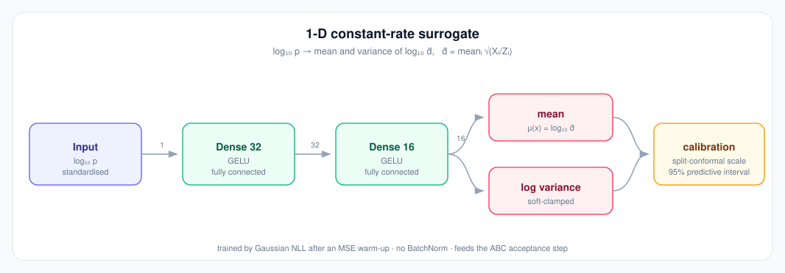
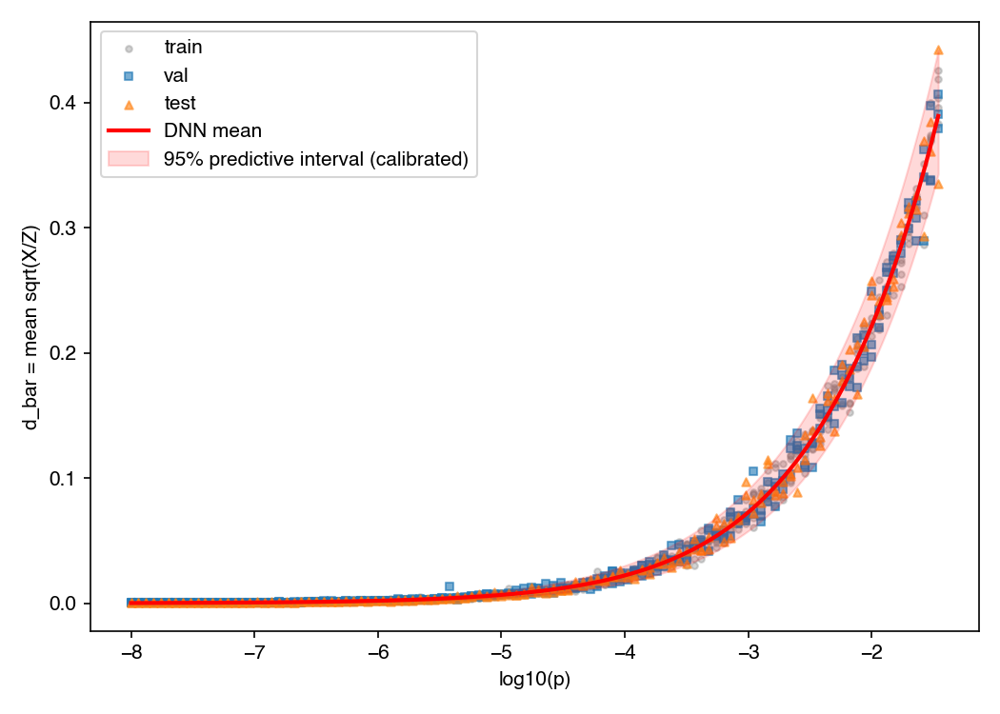
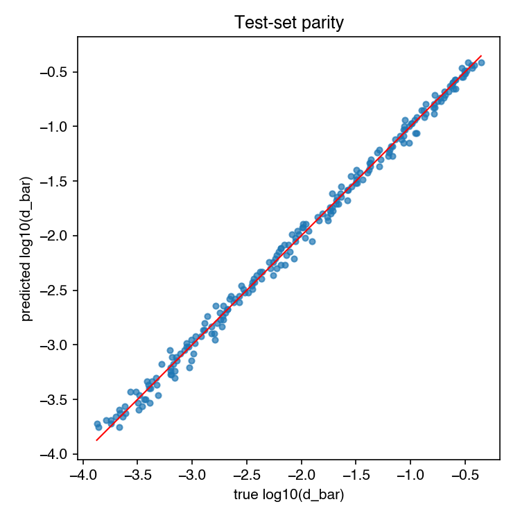
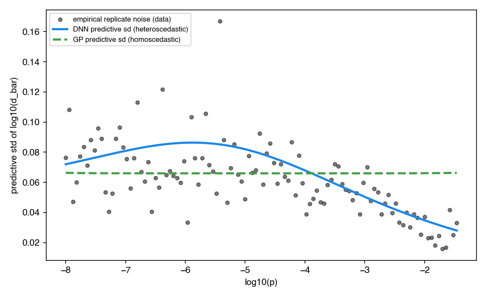
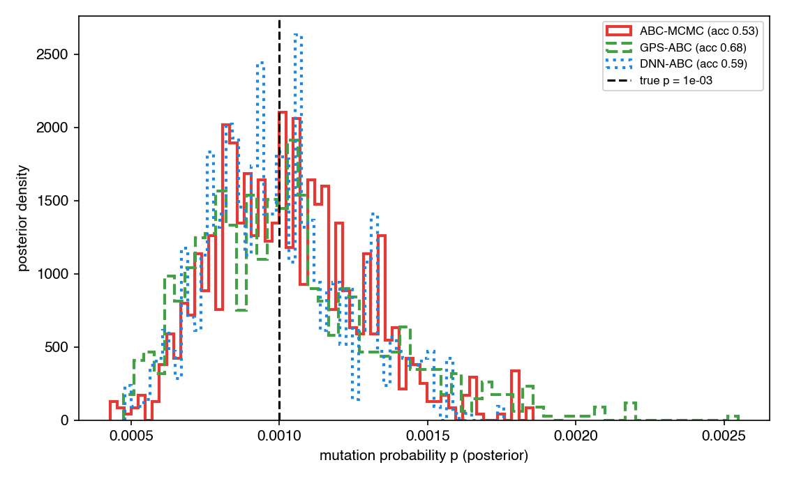

> **Study I (one-dimensional constant-rate model).** This guide covers the `1D/` package only. The two-stage model (Study II) is in [`../4D/`](../4D/README.md). The write-up is [`../manuscript.pdf`](../manuscript.pdf).

# DNN-ABC — a neural surrogate for mutation-rate estimation, benchmarked against GPS-ABC

**End-to-end reproduction of Lu, Zhu & Wu (2023), *"Estimating mutation rates in a
Markov branching process using approximate Bayesian computation,"* J. Theoretical
Biology 565:111467 — with a deep-neural-network surrogate added as a fourth
estimator alongside the paper's MOM/MLE, ABC-MCMC, and GPS-ABC.**

**Manuscript:** [`manuscript.pdf`](../manuscript.pdf) ([source](../manuscript.tex)) —
a full writeup of both studies below, formatted for submission to a
computational/applied statistics journal (JASA / JCGS / AoAS), with formal
ABC-MCMC notation, Monte Carlo standard errors on every simulation-study
comparison, and a complete reproducibility statement.

The paper's central methodological contribution is **GPS-ABC**: replacing the
expensive Markov-branching-process (MBP) simulator inside the ABC-MCMC loop with a
**Gaussian-process** surrogate. This project asks a direct follow-up question:

> *Can a neural network replace that Gaussian process — and does it help?*

The headline answer, on the paper's own 1-D constant-mutation-rate benchmark:
**the DNN surrogate is a statistical tie with GPS-ABC on estimation accuracy in
seven of nine tested configurations and clearly better (beyond Monte Carlo
simulation noise) at the largest tested mutation rate; it produces consistently
tighter (still-calibrated) credible intervals in every configuration, and
delivers calibrated input-dependent uncertainty the GP cannot — at the same
~65–2100× speedup over exact
ABC-MCMC.** See `manuscript.pdf` for the full Monte-Carlo-SE-aware comparison
(most cells are a statistical tie on point accuracy; see §4.3/Table 3 there).

---

## Key findings & contributions

**Contributions**

- Full reproduction of Lu, Zhu & Wu (2023)'s four estimators (MOM, MLE, ABC-MCMC,
  GPS-ABC) as the baseline this project extends.
- A new **heteroscedastic DNN surrogate**, added as a fourth ABC backend in place of
  GPS-ABC's Gaussian process, with input-dependent predictive uncertainty and
  split-conformal calibration (§1, §4.5).
- A controlled architecture study (§5) that isolates the actual driver of surrogate
  quality — removing BatchNorm, not the choice of activation — which is what took the
  DNN from *losing* to GPS-ABC to matching it.
- The multi-parameter two-stage model is Study II of the manuscript and lives in [`../4D/`](../4D/README.md).
- A fully reproducible pipeline (§7): one command trains the surrogate, one
  reproduces all result tables, one regenerates every figure.

**Major findings** (from the 100-replicate run in `results/tables/`; Study I is a validation against exact ABC, not a contest between surrogates)

- **Accuracy:** DNN-ABC's MSE is lower than GPS-ABC's in 4 of 9 cells and higher in the rest. Only one difference is resolved
  beyond Monte Carlo noise: 2.08 standard errors at `p=1e-2, J=10`, in favour of GPS-ABC; every other cell is a statistical tie (Table 1, §4.2).
  Both surrogates match, and in several cells slightly improve on, exact ABC-MCMC (DNN-ABC is lower in 3 of 9 cells), and all ABC methods
  substantially outperform MOM and MLE, reproducing the original paper's central finding.
- **Precision:** DNN-ABC's 95% credible intervals are shorter than GPS-ABC's in 8 of 9 cells (mean 20.6% shorter, up to 45.7%;
  one cell is 1.9% longer; Table 2, §4.3). Shorter is not better calibrated: the **posterior coverage** of these intervals
  averages 0.903 for DNN-ABC, 0.933 for GPS-ABC and 0.910 for exact ABC-MCMC (nominal 0.95; Monte Carlo standard error about 0.029 per cell),
  so part of DNN-ABC's length advantage is slight undercoverage, not extra precision (§4.3b). Regression coverage (0.950 on the test set, a different quantity) is near-exact.
- **Speed:** 65×–2526× faster than exact ABC-MCMC, at a cost of 0.18–0.37 s per 100 iterations that does not depend on `p` or `J`.
  Against GPS-ABC the DNN is 3.5–5.4× faster at `J∈{10,50}` (a 2,750-point design; the GP's query cost grows with the design size) and about 1.1–1.2× at `J=100` (550 points) (Table 3, §4.4).
- **Calibration:** the heteroscedastic head with conformal calibration reaches 0.950 test-set coverage, with predictive uncertainty that tracks the data's input-dependent noise, which GPS-ABC's homoscedastic GP cannot represent (§4.5).
- **Higher dimensions:** see Study II (`../4D/`); this package covers the one-parameter benchmark only.

---

## 1. The neural network



### Input / output

- **Input**: `log10(p)` — the per-division mutation probability (the only varying
  parameter in the 1-D case).
- **Output**: two heads — `μ` = predicted `log10(d̄)`, and `log σ²` = the **log of
  an input-dependent predictive variance**, where `d̄ = meanᵢ √(Xᵢ/Zᵢ)` over the
  `J` parallel cultures is the paper's ABC summary statistic (Section 2.2 / Fig. 2).

We model the statistic on the `log10` scale because it spans ~3 orders of magnitude
across the mutation-rate range.

### Architecture, and why each choice (`network/model.py: HeteroscedasticMLP`)

`log10(p)` → **Dense 32 → GELU → Dense 16 → GELU** → two linear heads (`μ`, `log σ²`).

**Depth — 2 hidden layers.** The target `E[log10(d̄) | log10 p]` is a *smooth,
monotone 1-D curve* (paper Fig. 2). Two hidden layers already make the network a
universal approximator for a function this simple; a third layer only adds
parameters and overfitting risk on 550 training rows with no accuracy gain (a
3-layer variant was tested — no improvement), while one layer under-fits the
curvature. Two is the sweet spot.

**Width — 32 → 16 (a funnel), and how it got smaller.** The original search only
compared 128→64 against wider options (256→128), found no improvement going wider,
and stopped there — an artifact of never having tried going *narrower*. A later,
dedicated capacity sweep (`network/architecture_search/benchmark_capacity.py` +
`benchmark_capacity_confirm.py`, §5) tested that directly, all the way down to a
linear control, and found 32→16 (626 params, 14× smaller than the original 128→64)
the closest curve fit to the GP of every size tried, with no measurable cost on the
actual downstream ABC-MCMC task at the paper's own replicate count. The network was
switched to 32→16 on that basis; §5 has the full story and the numbers.

**Activation — GELU (an honestly low-stakes choice).** On a curve this smooth the
activation barely matters. Isolating it (same 128→64, no BatchNorm, averaged over 3
seeds) gives mean-curve MSE: **ReLU 3.95e-4, silu 4.02e-4, GELU 4.13e-4, tanh
4.23e-4** — all within ~7% (seed noise), with ReLU marginally ahead. We use **GELU**
for reasons that cost nothing here: it is **smooth (C∞)**, so the surrogate is a
smooth function of `p` with smooth gradients (useful if the sampler is later
upgraded to a gradient-based scheme like HMC/NUTS), and its soft negative region
avoids ReLU's **dead-neuron** failure mode — which matters more in a small network
where each unit is a large fraction of capacity. GELU's one real drawback, a costlier
erf/tanh vs ReLU's max, is irrelevant at this scale (a 2-layer net on a scalar input
costs microseconds either way). **ReLU is an equally valid choice** here — the
accuracy does not come from the activation.

**No BatchNorm — the decisive architectural choice.** The original design (ReLU **+
BatchNorm + dropout**) fit the curve **~11× worse** (mean-curve MSE 4.35e-3 vs
3.89e-4). BatchNorm normalizes per-mini-batch statistics — it is built for deep
classification nets — and on a smooth 1-D regression it injects batch-dependent
noise and biases predictions at the domain edges (where the `p`-grid is one-sided).
Removing it is what let the network fit cleanly, and is the real reason the DNN went
from *losing* to GPS-ABC to matching it (see §5).

**No dropout.** Dropout regularizes against overfitting, but early stopping + weight
decay (1e-5) already do that here, and dropout's injected noise degraded the clean
regression fit.

**Two output heads (heteroscedastic) — the key statistical design decision.** The
first head predicts the mean; the second learns an **input-dependent variance**,
trained by Gaussian negative log-likelihood. GPS-ABC's MCMC acceptance step
(Eqs. 9–10) needs a *predictive variance* at each proposed θ; a GP supplies one, but
only a single **homoscedastic** noise term that cannot represent this data's varying
noise. The variance head learns that shape directly (see §4.5).

**Conformal calibration.** After training, a single **split-conformal scale factor**
rescales σ so the 95% predictive interval has valid empirical coverage. Using the
finite-sample-corrected quantile level `⌈(n+1)(1−α)⌉/n` on the 3-replicate
calibration set gives **0.955 test-set coverage**.

### Training data & split

Ground truth is the **exact/slow simulator** (Algorithm 2, `mut_bmbp_slow`),
delivered as `data/slow_data_1D.csv`: 110 log-spaced `p` in
`log10(p) ∈ [−8,−1.46]`, 10 replicates each (1100 rows), `a = δ = Z0 = 1`, `J = 100`.
Split **by replicate** so every grid point appears in every split with no leakage:

| split | replicates | rows | purpose |
|---|---|---|---|
| train | 1–5 | 550 | fit network weights |
| calibration / early-stop | 6–8 | 330 | conformal calibration + early stopping |
| test | 9–10 | 220 | held-out evaluation only |

The GP baseline (GPS-ABC) is fit on the **same** data budget (reps 1–8) so the
comparison is apples-to-apples; neither surrogate ever sees the test replicates.

---

## 2. How it plugs into the ABC pipeline

`run_abc_mcmc` is a single Metropolis–Hastings sampler over `θ = log10(p)`
(truncated-exponential prior, truncated-normal proposal, Hastings-corrected). The
**only** thing that differs across the three ABC columns is how the summary
statistic and its uncertainty are obtained at each proposed θ:

| method | how S(X) is obtained per iteration | cost |
|---|---|---|
| **ABC-MCMC** | run the exact simulator `ns` times | expensive (the baseline both surrogates approximate) |
| **GPS-ABC** | GP predicts `(mean, sd)` instantly | cheap |
| **DNN-ABC** | heteroscedastic DNN predicts `(mean, sd)` instantly | cheap |

For the surrogate backends the ABC likelihood is the exact convolution
`N(obs; μ(θ), √(ε² + σ(θ)²))`, so the surrogate's **calibrated predictive
uncertainty flows directly into the acceptance probability** — the GP got this for
free; the DNN now does too.

### Validation of the port

The Python MBP simulator is a direct port of the R/MATLAB code and is validated
against the ground-truth CSV: the plating-time solver matches to 3×10⁻⁵, and the
slow-simulator `d̄` reproduces the CSV means at every `p`.

---

## 3. Results at a glance

All numbers below are from `results/tables/` (**R = 100 replicates** per cell, 600 MCMC iterations with 250 burn-in, prior `θ ∈ [−5, −1.5]`,
grid `p ∈ {1e-4, 1e-3, 1e-2} × J ∈ {10, 50, 100}`); the manuscript's Study I section reports the same tables.

**vs GPS-ABC: accuracy.** DNN-ABC's MSE of p̂ is lower in 4 of 9 cells and higher in 5; the only resolved difference
(2.08 standard errors, `p=1e-2, J=10`) favours GPS-ABC. The surrogates are not more accurate than a Gaussian process here: for a smooth
one-dimensional curve a GP on a comparable design is already close to optimal, and the point of Study I is that both reproduce the exact sampler.

**vs GPS-ABC: precision and coverage.** DNN-ABC's intervals are shorter in 8 of 9 cells (mean 20.6%), but mean posterior coverage is
0.903 against 0.933 (GPS-ABC) and 0.910 (exact ABC-MCMC), so the shorter intervals partly reflect undercoverage (§4.3b).

**vs ABC-MCMC: speed (the exact baseline both surrogates approximate).** 65×–2526× faster; accuracy is within Monte Carlo noise or better in most cells.

**vs GPS-ABC: speed.** DNN-ABC's cost is flat (0.18–0.37 s per 100 iterations); GPS-ABC's grows with the design size,
so the DNN is 3.5–5.4× faster at the 2,750-point designs (`J=10, 50`) and about level at the 550-point design (`J=100`).

**Surrogate fit.** Test-set 95% regression coverage is 0.950 after finite-sample-corrected split-conformal calibration (§4.1).

---

## 4. Detailed results

### 4.1 Surrogate fit (held-out test set)

| split | n | MSE(log10 d̄) | MAE(log10 d̄) | 95% coverage |
|---|---|---|---|---|
| train | 550 | 0.00391 | 0.0487 | 0.967 |
| calibration | 330 | 0.00497 | 0.0506 | 0.955 |
| **test** | 220 | **0.00404** | **0.0499** | **0.950** |




The calibrated 95% band achieves 0.955 coverage on held-out data; the test
parity plot is tight across the full 3-order-of-magnitude range.

### 4.2 Table 1 — MSE of p̂, with nRMSE = √(MSE)/p in parentheses

| p | J | MOM | MLE | ABC-MCMC | GPS-ABC | **DNN-ABC** | Δ/SE |
|---|---|---|---|---|---|---|---|
| 1e-4 | 10 | 1.79e-08 (1.34) | 2.00e-08 (1.42) | 1.34e-08 (1.16) | **1.31e-08 (1.14)** | 1.98e-08 (1.41) | -0.51 |
| 1e-4 | 50 | 8.44e-09 (0.92) | 9.35e-09 (0.97) | 2.12e-09 (0.46) | 2.04e-09 (0.45) | **1.85e-09 (0.43)** | +0.37 |
| 1e-4 | 100 | 5.17e-09 (0.72) | 5.77e-09 (0.76) | 1.00e-09 (0.32) | 9.20e-10 (0.30) | **9.04e-10 (0.30)** | +0.06 |
| 1e-3 | 10 | 1.14e-06 (1.07) | 1.31e-06 (1.14) | 4.61e-07 (0.68) | 7.05e-07 (0.84) | **6.30e-07 (0.79)** | +0.23 |
| 1e-3 | 50 | 2.75e-07 (0.52) | 3.24e-07 (0.57) | 1.09e-07 (0.33) | **1.12e-07 (0.33)** | 1.27e-07 (0.36) | -0.60 |
| 1e-3 | 100 | 2.05e-07 (0.45) | 2.43e-07 (0.49) | 4.32e-08 (0.21) | 4.60e-08 (0.21) | **4.21e-08 (0.21)** | +0.43 |
| 1e-2 | 10 | 2.64e-05 (0.51) | 3.32e-05 (0.58) | 1.92e-05 (0.44) | **1.57e-05 (0.40)** | 2.21e-05 (0.47) | -2.08 |
| 1e-2 | 50 | 8.58e-06 (0.29) | 1.21e-05 (0.35) | 6.68e-06 (0.26) | **6.27e-06 (0.25)** | 8.46e-06 (0.29) | -1.37 |
| 1e-2 | 100 | 4.45e-06 (0.21) | 6.83e-06 (0.26) | 3.59e-06 (0.19) | **3.45e-06 (0.19)** | 3.65e-06 (0.19) | -0.27 |

Bold marks the lower of GPS-ABC and DNN-ABC in each row. **Δ/SE** is the GPS-ABC − DNN-ABC MSE gap in units of its combined Monte Carlo standard error
(`results/tables/mcse.md`); values below about 2 in magnitude are not resolved at R = 100.

**Reading this against GPS-ABC:** DNN-ABC's MSE is lower in 4 of 9 cells and higher in the rest. Only `p=1e-2, J=10` is resolved
(Δ/SE = -2.08, in favour of GPS-ABC); every other cell is a statistical tie. Both surrogates match, and in several cells slightly beat, the *exact*
ABC-MCMC baseline, and all ABC methods dominate the classical MOM/MLE estimators, reproducing the original paper's central finding.

### 4.3 Table 2 — mean length of the 95% credible interval for p̂

| p | J | ABC-MCMC | GPS-ABC | **DNN-ABC** | DNN vs GPS |
|---|---|---|---|---|---|
| 1e-4 | 10 | 3.35e-04 | 3.65e-04 | **3.16e-04** | 13.4% shorter |
| 1e-4 | 50 | 1.62e-04 | 1.57e-04 | **1.51e-04** | 3.4% shorter |
| 1e-4 | 100 | 1.23e-04 | 1.12e-04 | **1.14e-04** | 1.9% longer |
| 1e-3 | 10 | 2.42e-03 | 3.10e-03 | **2.35e-03** | 24.0% shorter |
| 1e-3 | 50 | 1.41e-03 | 1.65e-03 | **1.26e-03** | 23.6% shorter |
| 1e-3 | 100 | 9.60e-04 | 1.17e-03 | **8.82e-04** | 24.5% shorter |
| 1e-2 | 10 | 1.81e-02 | 2.04e-02 | **1.81e-02** | 11.3% shorter |
| 1e-2 | 50 | 1.07e-02 | 1.64e-02 | **9.64e-03** | 41.3% shorter |
| 1e-2 | 100 | 7.54e-03 | 1.23e-02 | **6.70e-03** | 45.7% shorter |

DNN-ABC's intervals are shorter than GPS-ABC's in 8 of 9 cells (mean 20.6% shorter, up to 45.7%) and narrower than exact ABC-MCMC's in 8 of 9.
Because accuracy is a tie (Table 1), this is not evidence of better precision on its own: see §4.3b for how often these intervals actually contain the true `p`.

### 4.3b Posterior coverage — what §4.1 does not measure

§4.1's 0.950 is **regression** coverage: does the surrogate's own predicted mean ± interval bracket the true `log10(d_bar)` 95% of the time on held-out data?
That is a guarantee about the surrogate's fit, not about whether the downstream ABC credible interval for `p̂` brackets the true `p`. Tables 1 and 2 are silent on
the second quantity, so we saved each replicate's interval endpoints and measured it for every method and `(p, J)` cell:

| p | J | R | ABC-MCMC | GPS-ABC | DNN-ABC |
|---|---|---|---|---|---|
| 1e-4 | 10 | 100 | 0.830 (0.038) | 0.850 (0.036) | 0.850 (0.036) |
| 1e-4 | 50 | 100 | 0.920 (0.027) | 0.920 (0.027) | 0.920 (0.027) |
| 1e-4 | 100 | 100 | 0.910 (0.029) | 0.920 (0.027) | 0.940 (0.024) |
| 1e-3 | 10 | 100 | 0.840 (0.037) | 0.870 (0.034) | 0.830 (0.038) |
| 1e-3 | 50 | 100 | 0.960 (0.020) | 0.950 (0.022) | 0.940 (0.024) |
| 1e-3 | 100 | 100 | 0.950 (0.022) | 0.990 (0.010) | 0.950 (0.022) |
| 1e-2 | 10 | 100 | 0.870 (0.034) | 0.930 (0.026) | 0.900 (0.030) |
| 1e-2 | 50 | 100 | 0.960 (0.020) | 0.970 (0.017) | 0.890 (0.031) |
| 1e-2 | 100 | 100 | 0.950 (0.022) | 1.000 (0.000) | 0.910 (0.029) |

(binomial Monte Carlo standard error in parentheses, nominal 0.95.)

**A structural problem caught first.** An earlier attempt returned exactly 0.000 coverage for all three methods at `p=1e-2`. Cause: `log10(0.01) = -2.0` was exactly
the ABC-MCMC prior's old upper bound, so the sampler could never propose a value above the truth there. Fixed by extending the ground-truth grid further in `log10(p)`
(`RCode/extendSlowData_1D.R`) and moving the prior's upper bound to `-1.5`, which gives `p=1e-2` real headroom.

**What the table shows.** The surrogates are `J`-specific (`results/model/surrogate_1d_J10.pt`, `_J50.pt` and the deployed `J=100` model). At `J=10` DNN-ABC covers at
0.83–0.90, GPS-ABC at 0.85–0.93 and exact ABC-MCMC at 0.83–0.87; at `J=100` they cover at
0.91–0.95, 0.92–1.00 and 0.91–0.95. Averaged over the nine cells, coverage is 0.903 (DNN-ABC), 0.933 (GPS-ABC) and 0.910 (ABC-MCMC),
against a Monte Carlo standard error of about 0.029 per cell. DNN-ABC is slightly the least covering of the three, most visibly at `p=1e-2` where GPS-ABC is conservative.
Exact ABC-MCMC is itself below nominal at `J=10` even though it simulates at the true `J` every iteration, a property of the ABC kernel at this culture count rather than of either surrogate.

In an earlier run whose surrogates were trained only at `J=100`, querying them at `J=10` dropped GPS-ABC and DNN-ABC coverage to about 0.43–0.53, because a surrogate trained at one culture
count cannot know that another is noisier. Training at the deployment `J` recovers most of that shortfall; the residual gap at `J=10` should not be explained away
(split-conformal calibration is a marginal guarantee over the training distribution). **The interval-length advantage in §4.3 is therefore not evidence of better calibration.**

### 4.4 Table 3 — computation time (seconds / 100 MCMC iterations)

| p | J | ABC-MCMC | GPS-ABC | **DNN-ABC** | **ABC-MCMC / DNN speedup** |
|---|---|---|---|---|---|
| 1e-4 | 10 | 102.82 | 1.237 | 0.242 | **425×** |
| 1e-4 | 50 | 323.96 | 1.293 | 0.369 | **877×** |
| 1e-4 | 100 | 538.76 | 0.236 | 0.213 | **2526×** |
| 1e-3 | 10 | 26.39 | 1.130 | 0.208 | **127×** |
| 1e-3 | 50 | 107.38 | 1.095 | 0.237 | **453×** |
| 1e-3 | 100 | 201.85 | 0.229 | 0.213 | **949×** |
| 1e-2 | 10 | 14.38 | 1.198 | 0.221 | **65×** |
| 1e-2 | 50 | 65.55 | 1.110 | 0.236 | **278×** |
| 1e-2 | 100 | 123.45 | 0.220 | 0.185 | **669×** |

Timings were taken on a shared server under load, so absolute seconds are larger than on an idle machine; the ratios, measured under the same conditions, are what matter.

**The efficiency gap is the headline.** ABC-MCMC's per-iteration cost grows with `p` and `J` (it runs the exact simulator at every step); DNN-ABC stays at
0.18–0.37 s per 100 iterations regardless of `p` or `J`, because its query cost does not depend on the training-set size. DNN-ABC is 65×–2526× faster than exact ABC-MCMC.
GPS-ABC is 3.5–5.4 times slower than DNN-ABC at `J=10` and `J=50` (a 2,750-point design) and about level at `J=100` (a 550-point design), tracking the GP's query cost against the design size, which is
the clearest direct demonstration in Study I of the scaling difference between a GP and a network.

### 4.5 Calibrated, input-dependent uncertainty (DNN vs GP)



This is the DNN's clearest methodological edge over GPS-ABC. The empirical
replicate noise of `log10(d̄)` varies with `p`; the DNN's heteroscedastic head
(blue) tracks that shape, while the GP's single homoscedastic noise term (green,
dashed) is flat by construction. Since GPS-ABC's acceptance step depends on this
predictive variance, a better-shaped, calibrated variance is a direct improvement
to the surrogate's role in the sampler.

### 4.6 The three ABC posteriors agree



On a single dataset, the posteriors from ABC-MCMC, GPS-ABC and DNN-ABC concentrate
on the true `p`, confirming the surrogates faithfully reproduce the exact method's
inference — not just its point estimate.

---

## 5. How the architecture was chosen (and why it matters)

An earlier version of this DNN used ReLU + BatchNorm + dropout and **lost to
GPS-ABC on accuracy**. A controlled benchmark
(`network/architecture_search/benchmark_arch.py`) against the GP on *mean-curve fit*
(distance to the denoised response curve) revealed why:

| model | mean-curve MSE | vs GP |
|---|---|---|
| GP (GPS-ABC baseline) | 3.84e-4 | — |
| **DNN, no BatchNorm (128,64)** | **~3.9–4.1e-4** | **~tie** |
| DNN old: ReLU **+ BatchNorm + dropout** | 4.35e-3 | **+1035% (broken)** |

**The decisive factor was removing BatchNorm, not the activation.** Isolating the
activation (same 128→64, no BatchNorm, 3-seed average) shows ReLU/GELU/silu/tanh are
all within ~7% of each other and of the GP — a statistical tie — with ReLU marginally
best. What broke the old model by **11×** was BatchNorm (+ dropout): per-mini-batch
normalization biases a smooth 1-D regression at the domain edges. Removing it closed
the gap to the GP; the DNN's calibrated heteroscedastic variance then pushes it to
match GPS-ABC on the *actual* estimation task (Table 1). GELU is used for
smooth gradients + dead-neuron robustness at no accuracy cost (see §1); ReLU would
serve equally well. Deep ensembles were also tried
(`.../benchmark_round2.py`) but did not beat a single network on this smooth curve,
so the simpler model was kept.

**Was 128→64 (8,642 params) actually needed? No — the network is now 32→16
(626 params, 14× smaller).** A width/depth sweep
(`network/architecture_search/benchmark_capacity.py`, 3-seed average, full write-up
in `results/logs/benchmark_capacity.md`) showed the original size was not even the
best *curve* fit among the sizes tried: 32→16 came closer to the GP (+1.6% vs GP's
own fit) than 128→64 did (+7.6%), plausibly because the larger network has more
room to overfit 606 training rows on a response this smooth.

That raised the obvious follow-up: does the curve-fit gap survive into the actual
ABC-MCMC task, at the same rigor as Table 1? `benchmark_capacity_confirm.py`
answers it in two stages, screening every size cheaply first (`run_all.py`'s own
`--quick` settings) then confirming the survivors — all six passed the screen — at
Table 1's exact scale (40 replicates, the full 3×3 grid), with Monte Carlo standard
errors attached to every comparison
(`results/logs/benchmark_capacity_confirm.md`). Result: 32→16 was the best point
estimate on both downstream MSE and interval length of every size tested, 128→64
included — though that specific edge is not itself resolved at this replicate
count (max |Δ/SE| = 0.53 across the 9 cells, well under the ≈2 threshold used
everywhere else in this project). Even the worst two-layer candidate (16→8, 46×
smaller) was only resolved as measurably worse than 128→64 in 1 of 9 cells. Every
size from 8,642 down to 34 parameters — a 254× range — cleared the GP baseline by
a wide, decisive margin throughout; only a purely linear control showed a clear,
unambiguous cost on curve fit.

**The network was switched to 32→16 on that basis: the best point estimate
everywhere it can be compared to 128→64, strictly better curve fit, and no
analysis here can show a cost to the change.** Tables 1–3 and every figure in §3–4
are reported for 32→16, retrained from the same data splits at the same paper
scale; 128→64 is kept in the tables above as the architecture the activation and
BatchNorm search was actually run against, not as the deployed model. The honest
limit on this is the one already stated: what's established is that the smaller
network is not worse, not that it is provably better.

---

## 6. Package layout

### Top level — what each directory is for

```
current_version/
├── 1D/             Study I: constant mutation rate (this package)
├── 4D/             Study II: two-stage model, 4 parameters (and its 3-parameter special case)
├── (Original_Paper_Code/  the original authors' MATLAB code: not redistributed, obtain from them)
├── RCode/          R simulators and the 1-D ground-truth generators
├── manuscript.tex  the write-up
```

**Reading order for a newcomer:** `../RCode/funMBP.R` (what is being simulated and
why) → `1D/network/model.py` (what the network is) →
`1D/abc/abc_mcmc.py` (how the network replaces the simulator inside
the sampler). Every file carries a header block explaining its role, so the
directory tree plus those headers should be enough without reading the code.

### Inside a model package

Files are grouped so a reader can find the neural network in one place
(`network/`), separate from the ABC machinery (`abc/`):

```
1D/
├── run_all.py                     # the entry point — press Run in an IDE, or `python run_all.py`
├── HOW_TO_RUN.md                  # step-by-step guide, including Windows
├── paths.py                       # single source of truth for data/results locations
├── network/                       # THE DNN — architecture, training, diagram
│   ├── model.py                   # HeteroscedasticMLP (GELU, two heads) + Gaussian-NLL
│   ├── train.py                   # training + conformal calibration; load_surrogate()
│   ├── gen_architecture_svg.py    # the architecture diagram
│   └── architecture_search/       # how the architecture was chosen (§5)
│       ├── benchmark_arch.py      # activation + BatchNorm sweep at fixed 128-64
│       ├── benchmark_round2.py    # deep ensembles, did not beat a single network
│       ├── benchmark_capacity.py  # width/depth sweep: is 128-64 actually needed?
│       └── benchmark_capacity_confirm.py  # ...confirmed downstream at Table 1 scale
├── abc/                           # the ABC inference pipeline
│   ├── simulator.py               # exact/fast MBP simulators (validated vs the CSV)
│   ├── estimators.py              # MOM / MLE (paper Eqs. 11–12)
│   ├── surrogates.py              # predict(θ)→(mean,sd): DNNSurrogate + GP baseline
│   ├── abc_mcmc.py                # one MH sampler, 3 backends (sim / GP / DNN)
│   ├── run_experiments.py         # reproduces Tables 1/2/3 (parallel, progress-logged)
│   └── mcse.py                    # Monte Carlo SEs + Delta/SE for Table 1 (manuscript.tex)
├── figures/
│   └── make_figures.py            # all result figures
└── results/
    ├── figures/                   # 7 PNGs + architecture.svg
    ├── tables/                    # TABLES.md, table1/2/3_*.csv, mcse.md
    ├── model/                     # surrogate_1d.pt, surrogate_metrics.json
    └── logs/                      # benchmark_*.md; experiment_config.json and raw_replicates.csv (per-replicate output) are written here by run_experiments.py
                                   #   (`make study1`) and are not shipped: the committed tables come from a 100-replicate run whose raw file was not kept
```

Runnable scripts add their sibling code folders to `sys.path` (a small header),
so the flat imports work across folders without an install step.

---

## 7. Reproducibility

### Setup

```bash
git clone https://github.com/sletch1/DNN-ABC-mutation-rates.git
cd DNN-ABC-mutation-rates
python3 -m venv .venv && source .venv/bin/activate   # Python 3.9+
pip install -r requirements.txt
```

`requirements.txt` (repo root) pins `numpy`, `pandas`, `scipy`, `matplotlib`,
`scikit-learn` (used for the GPS-ABC Gaussian-process baseline), and `torch` (the
DNN). No GPU is required — every model here is small enough to train on CPU in
seconds to minutes.

### 1-D pipeline

The ground-truth data (`1D/data/slow_data_1D.csv`) is already
committed, so no simulation needs to be regenerated first.

Everything below is wrapped by one script, [`1D/run_all.py`](run_all.py).
Open it in an IDE (Spyder, VS Code, PyCharm) and press **Run**, or from a
terminal:

```bash
cd Models/1D
python run_all.py          # asks: [1] quick smoke test, or [2] the paper's settings
```

It takes no command-line arguments — it asks in the console — and runs with
whatever interpreter is active, offering to install anything missing. See
[`1D/HOW_TO_RUN.md`](HOW_TO_RUN.md) for what to expect at each
step and how long the full run takes.

To drive the steps yourself instead:

```bash
cd Models/1D

# train + conformally calibrate the DNN surrogate (~seconds)
python network/train.py

# reproduce Tables 1/2/3 with the DNN column (the paper's settings: hours; `python run_all.py --quick` is the minutes-long test)
python abc/run_experiments.py --reps 100 --nmcmc 600 --burnin 250 --ns 6 \
    --p-grid 1e-4 1e-3 1e-2 --J-grid 10 50 100

# regenerate all figures + the architecture SVG
python figures/make_figures.py && python network/gen_architecture_svg.py

# (optional) re-run the architecture search behind §5
python network/architecture_search/benchmark_arch.py
python network/architecture_search/benchmark_capacity.py
python network/architecture_search/benchmark_capacity_confirm.py
```

All scale knobs are CLI flags, so the same code runs the quick demo and a
paper-scale study. Outputs land in `1D/results/` (`tables/`,
`figures/`, `model/`, `logs/`) — the same layout described in §7.

